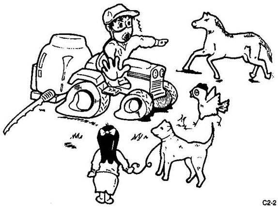
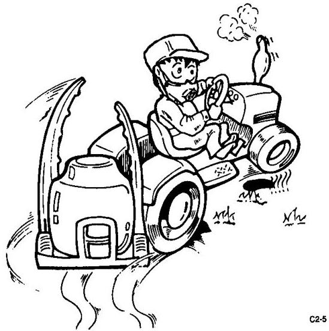
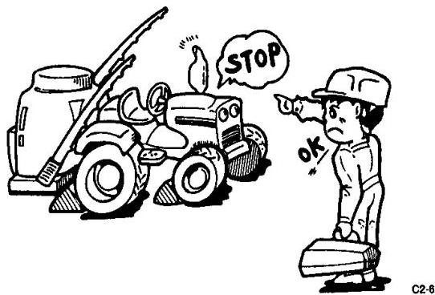
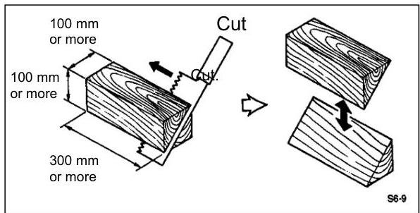
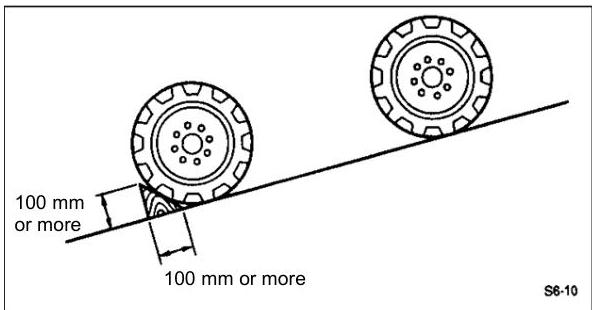

# Page 1

1

For Safe Work

## (1) Overview

Carefully read the “Operation Manual” and instruction manual of the agrichemical used, to carry out work correctly and safely.

[1] When using the boom sprayer installed on the tractor, make sure it is not tilted more than 5°.

[2] The person performing spraying should wear protective gears for agrichemical spraying (such as a pest control mask, protective glasses, boots, rubber gloves and waterproof protective cloth, etc.) to prevent the reagent from coming in direct contact with the body.

[3] Inspect/service and repair the boom sprayer on flat ground. To inspect/service the boom sprayer while still installed on the tractor, stop the engine on flat ground, apply the parking brake, remove the key, and extend the boom sprayer stand. Failure to do so may cause the tractor to move unexpectedly, resulting in an accident.

[5] Keep non-operators away from the area where pest control work is performed. Failure to do so may lead to an accident.

[6] Exercise due caution not to pollute water supply systems, rivers, lakes, ponds, etc.

[7] Never refuel near a fire source as it may cause fire. Refueling while smoking is strictly prohibited.

## (2) Precautions When Installing the Boom Sprayer on the Tractor

[1] Carefully read the operation manual for the tractor to familiarize yourself with the tractor operation.

[2] On flat ground, completely stop the tractor engine, PTO, etc., and be sure to perform startup inspection on the tractor and boom sprayer to prevent problems during pest control work. Startup Inspection: Page 22

[3] No one should stand between the tractor and boom sprayer. It may result in a serious accident.

[4] Securely connect the universal joint. Failure to do so may lead to malfunction.

[5] Strictly observe the instructions provided in the operation manual for the boom sprayer as to which tractor you can use to install the boom sprayer. It should be noted, however, that the overall weight and front-rear weight balance vary depending on the tractor. Put weights on the front side so that the loads applied to the steering wheels (front wheels) of the tractor will become 20% or more of the overall weight. If the weights are not balanced, the front wheels of the tractor will lift from the ground and cause an accident.

# Page 2

4

# (3) Driving

Clean water is sprayed for adjustment of spray pressure and spray check.

[1] Before driving the tractor, check the connection of the universal joint, etc. again, and installation of the options, etc.
[2] Do not increase the speed more than necessary and avoid sudden take-off, acceleration, braking or turning, to drive and work safely.
[3] When moving to a field or between fields, be sure to keep the boom closed (page 16).
[4] Always confirm safety when entering/exiting a field, crossing a channel or ditch between fields, or traveling on soft terrain, etc.
[5] Climb uphill in reverse gear to prevent the tractor from back-flipping.

Depending on how full or empty the reagent tank is, the center-of-gravity position may change to make the tractor unstable; accordingly, pay due attention to safety especially after filling the reagent tank.

# (4) Storage

[1] Store the boom sprayer safely on flat ground after inspecting/servicing the boom sprayer and with the boom sprayer stand extended.
[2] To store the boom sprayer while still installed on the tractor, be sure to extend the boom sprayer stand and lower the boom sprayer.

# (5) Chocking the Tires

Prepare concrete blocks, wooden blocks or other objects (10x10 cm or larger, 30 cm or longer) that can be used to chock the tires so that the tractor can be parked safely. Chock the bottom side of tires on the two wheels, one left and one right, on the lower side of the incline.

