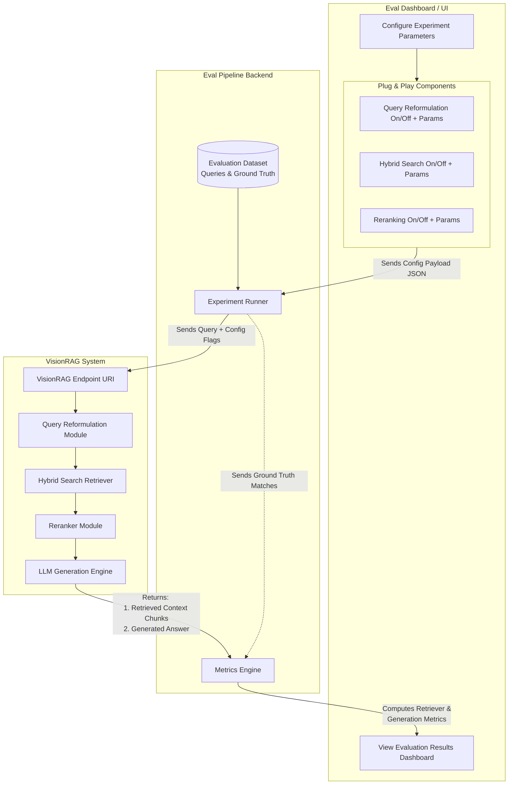
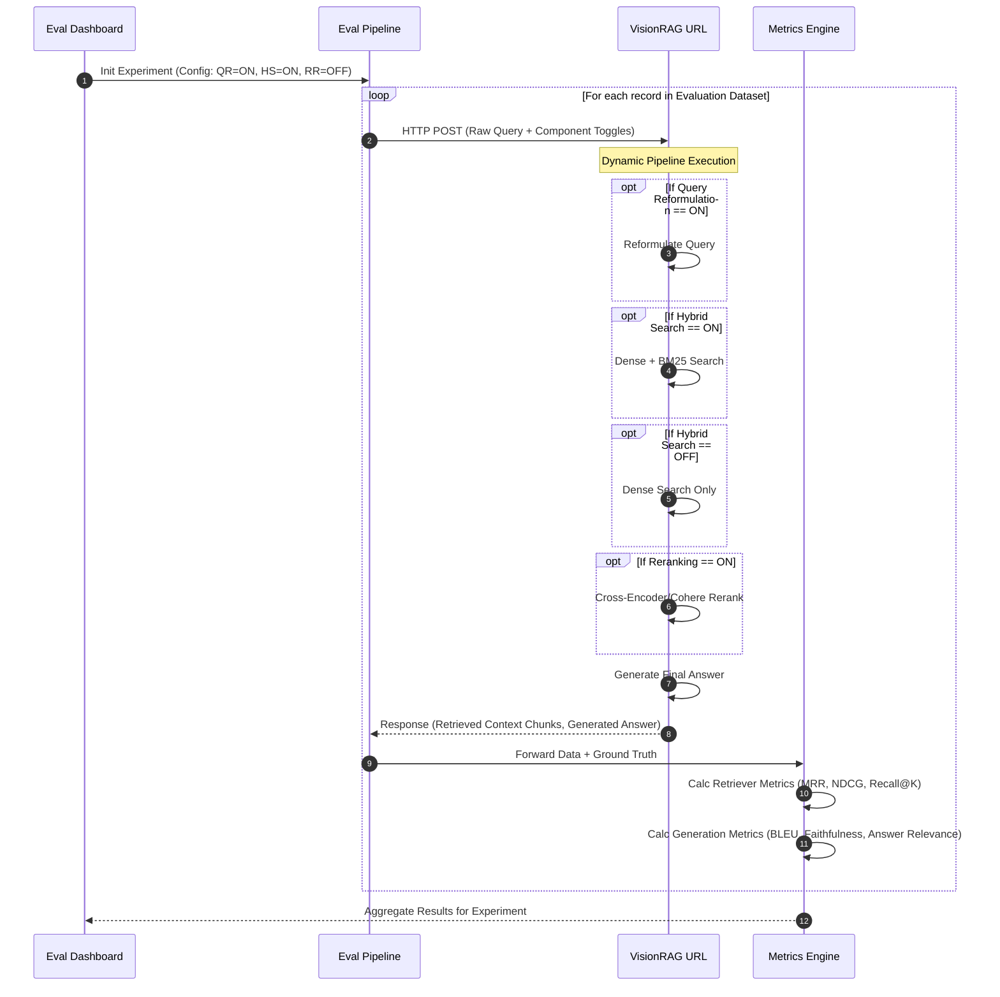

# VisionRAG Evaluation Pipeline Architecture

## High-Level Flow Diagram

The following flowchart outlines the structural components and how data flows from the Evaluation Dashboard, to the Pipeline orchestrator, into the VisionRAG API, and finally through the metrics calculation.

---

## Execution Sequence

This sequence diagram details step-by-step how a single evaluation experiment runs:

---

## Why Exactly Are We Doing This? (The Rationale)

Building the evaluation pipeline this way—with plug-and-play decoupling and separate metric scoring—solves several highly critical engineering challenges for RAG applications:

### 1. Component Ablation Studies (Isolating the value)
Modern RAG systems are complex. If your system's answers improve, you need to know **why**. Did the expensive Reranker fix the issue, or was it the Query Reformulation? By building these features as dynamic "toggles" (on/off buttons), you can run systematic *ablation studies* (A/B testing). You can scientifically prove the ROI (Return on Investment) of each specific component without having to manually change the VisionRAG source code between tests.

### 2. Identifying the "Failure Bottleneck" 
In RAG, bad answers happen for two main reasons:
*   **Retriever Failure:** The search engine didn't find the right document chunk. 
*   **Generation Failure (Hallucination):** The search engine found the right document, but the LLM ignored it or hallucinated a bad answer.

By specifically forcing VisionRAG to send back the *interim Retrieved Chunks* alongside the *Generated Answer*, the Metric Engine can score both independently. If the retrieval metrics are high but generation metrics are low, you know you need a better LLM prompt. If retrieval metrics are low, you know you need to tune your Hybrid Search.

### 3. Hyperparameter Optimization at Scale
Beyond simple "On/Off" states, passing parameters (like `top_k=10` or varying the weight of dense vs. sparse in hybrid search) straight from the dashboard allows non-engineers (or automated tuning scripts) to constantly calibrate the pipeline against a golden validation dataset to find the mathematically optimal configuration for VisionRAG.

### 4. Zero-Downtime Benchmarking
By decoupling the evaluation pipeline from the core application, you treat VisionRAG strictly as a black-box API. This ensures that benchmarking doesn't clutter or slow down production code, maintaining a strict boundary between testing protocols and your live environment.
